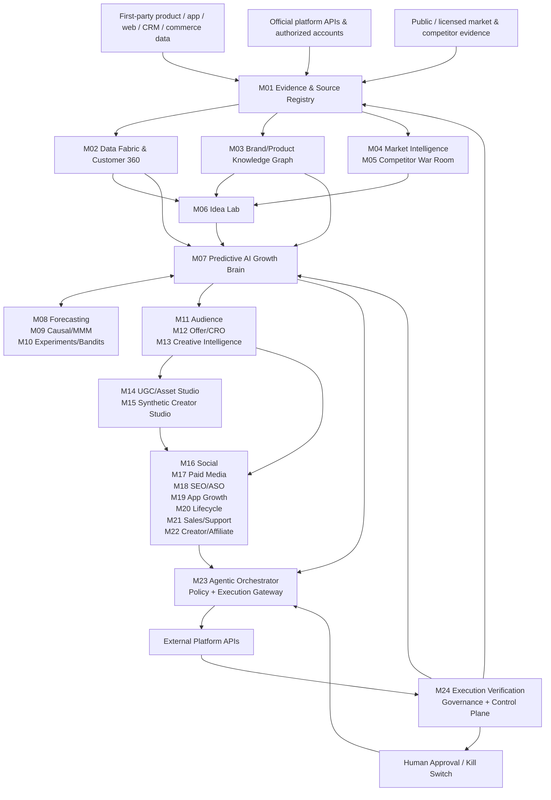
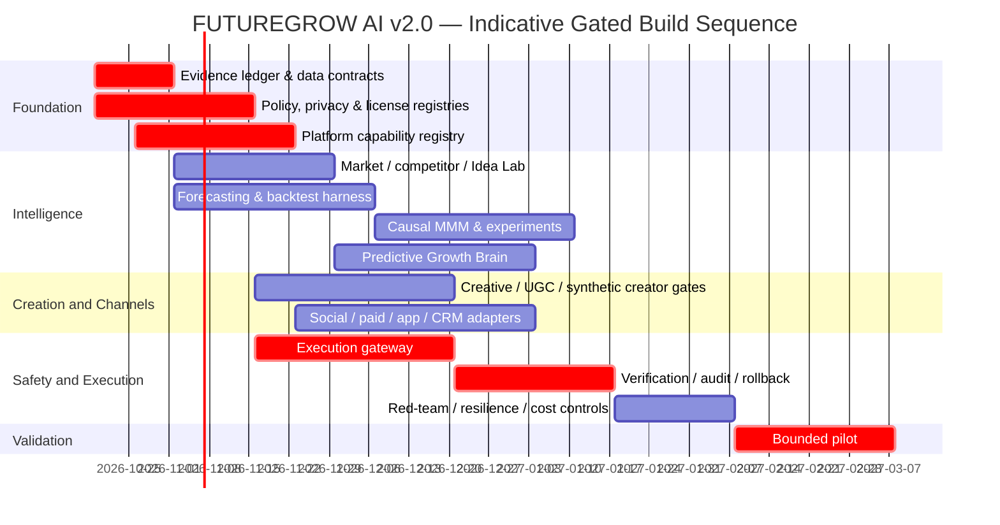

# FUTUREGROW AI — Final Master Product Blueprint v2.0

## Executive Summary

- FUTUREGROW should be an **evidence-first autonomous growth operating system**, not an unrestricted “AI that automatically does all marketing.” Every prediction, idea, campaign, creative, spend change, competitor observation, and execution must carry provenance, confidence, policy status, cost/risk, and verification evidence.
- The **Predictive AI Growth Brain must never claim perfect future detection, guaranteed sales, downloads, growth, or competitor domination**. It should produce calibrated probability distributions, scenarios, expected incremental value, uncertainty, and downside risk; forecasting, causal inference, MMM, and online experimentation must remain mathematically distinct. Meridian is explicitly Bayesian and supports causal MMM, experiment calibration, and budget optimization; probabilistic forecasting should likewise be backtested rather than treated as certainty. citeturn8view0turn20academia32
- The architecture should use **LangGraph-style durable orchestration rather than OpenAI Swarm as the production foundation**. Swarm's own repository describes it as experimental/educational and says it has been replaced for production use; LangGraph is the stronger open-source baseline for stateful, durable, human-in-the-loop workflows. citeturn18view2turn0search1turn0search9
- “Autonomous” must mean **bounded autonomy**: low-risk actions may execute inside pre-approved constraints, while spend increases, pricing changes, public publishing, sensitive targeting, data exports, synthetic-person campaigns, and legally sensitive claims pass configurable policy/human gates. Platform APIs impose independent permissions, audits, quotas, review processes, and feature restrictions; for example, TikTok requires authorization and `video.publish` approval and limits unaudited clients to private posts. citeturn14view0
- **Deceptive growth tactics are excluded**: fake engagement, fake reviews/testimonials, undisclosed material relationships, synthetic people presented as genuine customers, impersonation, spam, unauthorized account automation, access-control bypass, and unlawful competitor reverse engineering. FTC rules expressly cover fake or AI-generated reviews/testimonials and endorsement disclosure obligations. citeturn10view0turn11search13turn11search4
- The most important missing production layer is **Execution Verification**: no action becomes `SUCCESS` merely because an agent/API call returned `200`. FUTUREGROW needs read-after-write verification, state diffs, API receipts, content hashes, spend reconciliation, idempotency, retries, rollback/circuit breakers, audit trails, license manifests, consent enforcement, and continuous model/data quality monitoring.

## Evidence, Corrections, and Non-Negotiable Rules

**Evidence flags**

| Flag | Meaning |
|---|---|
| `[P]` | Primary/official source: first-party system, platform API, regulation, repository, contract, or customer-authorized data |
| `[R]` | Original/peer-reviewed research |
| `[D]` | FUTUREGROW design requirement or engineering decision |
| `[I]` | Explicit inference derived from evidence; must not be presented as a measured fact |
| `[U]` | Unspecified; implementation must not fabricate a value |
| `[BLOCK]` | Action prohibited until legal/policy/security prerequisites are satisfied |

**Minimum evidence object required for every material decision**

```yaml
evidence_record:
  evidence_id: required
  source_type: primary|research|secondary|internal
  source_owner: required
  source_uri_or_object_id: required
  retrieved_at: required
  observed_at: required_if_known
  geography: required_if_relevant
  lawful_basis_or_consent_id: required_if_personal_data
  platform_terms_version: required_if_external_platform
  license_or_usage_rights: required
  schema_version: required
  lineage_parent_ids: []
  pii_classification: required
  freshness_status: current|stale|unknown
  confidence: required
  permitted_uses: []
  prohibited_uses: []
```

A source with unknown provenance, unknown usage rights, unresolved consent, or unacceptable staleness may be stored in quarantine but **must not silently drive autonomous execution**.

### Verified corrections to earlier product assumptions

| Assumption | Final status | Required correction |
|---|---|---|
| “The brain can have perfect data and detect the future.” | **Incorrect.** | Data can be incomplete, biased, delayed, censored, noisy, or affected by platform changes. Produce predictive distributions, intervals, calibration/error metrics, and abstain when evidence is inadequate. `[D]` |
| “Competitor domination can be guaranteed mathematically.” | **Incorrect.** | Optimize expected competitive advantage and incremental outcomes; never guarantee market outcomes. `[D]` |
| “Attribution proves marketing caused the result.” | **Incorrect.** | Keep descriptive attribution separate from causal estimation. Use randomized experiments where feasible and causal/MMM methods when assumptions are documented. Meridian is explicitly designed for Bayesian MMM and experiment calibration. citeturn8view0 |
| “OpenAI Swarm should be the production swarm engine.” | **Outdated.** | Swarm is MIT-licensed but its official repository labels it experimental/educational and recommends migration away from it for production. Use LangGraph or another maintained production orchestrator behind an abstraction layer. citeturn18view2 |
| “n8n is normal open source.” | **Incorrect licensing assumption.** | n8n describes itself as fair-code and uses its Sustainable Use License plus Enterprise License; treat it as source-available, not the default permissively licensed core. citeturn7view0 |
| “ComfyUI being open source means every image/video model used through it is commercially safe.” | **Incorrect.** | ComfyUI itself is GPL-3.0, while checkpoints, LoRAs, plugins, voices, source media, and other assets carry independent licenses/rights. Some FLUX `[dev]` model weights, for example, use a non-commercial license even though the inference repository is Apache-2.0. citeturn7view4turn19search1 |
| “REA allows unrestricted competitor cloning.” | **Incorrect.** | REA-authored code is MIT, but its repository expressly preserves third-party licensing and says commercial reverse-engineering tools must be legally obtained/authorized. FUTUREGROW may invoke REA only on owned, licensed, publicly permissible, or explicitly authorized artifacts. citeturn18view5 |
| “Any AI influencer/profile can look like a real customer.” | **High legal/platform risk.** | Synthetic brand characters must be disclosed as synthetic where required and must not fabricate customer experience, celebrity endorsement, or material relationships. FTC rules prohibit fake reviews/testimonials, including AI-generated ones, and require clear endorsement disclosures. citeturn10view0turn11search13 |
| “Social publishing is universally automatable.” | **Incorrect.** | Automation depends on account type, OAuth scopes, platform review, rate limits, supported endpoints, user authorization, and regional/product rules. TikTok Direct Post, for example, requires approved scope and user authorization; unaudited clients are private-only. citeturn14view0 |
| “The old Google Ads developer-token onboarding can be hard-coded.” | **Outdated as of 2026.** | Google sunset developer tokens for ordinary Google Ads API access on September 9, 2026 and moved access levels to Google Cloud projects; integrations must be versioned from current documentation. citeturn14view3 |

### Non-negotiable operating rules

| Rule | Hard requirement |
|---|---|
| Evidence before action | Every consequential recommendation/execution has evidence IDs, freshness, provenance, confidence, and permitted-use state. |
| No certainty theater | Forecasts expose distributions/intervals and model error. `prediction == guarantee` is forbidden. |
| Causality boundary | Attribution, correlation, forecast, causal effect, MMM estimate, and randomized-test result are different data types. |
| Bounded autonomy | Every write action has a tenant policy, approved scope, budget/risk ceiling, idempotency key, and rollback/stop path. |
| Human-control tier | `[U]` tenant thresholds determine which spend, pricing, publishing, targeting, data export, or reputational actions require approval. |
| No deceptive growth | No fake reviews, fake followers/likes/comments, undisclosed paid endorsements, impersonation, hidden synthetic testimonials, spam, or coordinated inauthentic behavior. FTC endorsement/fake-review rules make several such patterns direct compliance risks. citeturn10view0turn11search13 |
| API-first execution | Use official/authorized APIs wherever available. No CAPTCHA bypass, stolen credentials, token sharing, or access-control circumvention. |
| Privacy by purpose | Collect only data required for an approved purpose; attach consent/lawful-basis, retention, deletion, and regional-use controls. California privacy rights include control over collection/use and opt-out rights; Google Play also places disclosure/deletion responsibilities on developers. citeturn21search1turn4view3 |
| Children/sensitive data gate | Age-sensitive or regulated data requires a separate policy path; COPPA was amended in 2025 and imposes specific obligations for covered services collecting children's personal information. citeturn21search25 |
| Messaging consent | Maintain suppression/preference state and jurisdiction-specific rules. U.S. commercial email is subject to CAN-SPAM requirements including truthful headers, opt-out mechanisms, and honoring opt-outs. citeturn21search6turn21search24 |
| Asset rights manifest | Every generated/published asset records source rights, model/checkpoint/license, plugins, prompts, identity/likeness authority, music/voice rights, and disclosure requirements. |
| Verified execution only | `SUCCESS` is illegal as an internal state until postconditions are independently verified. |
| Immutable audit | Preserve who/what proposed, approved, executed, changed, spent, published, failed, and rolled back. |
| Tenant isolation | Credentials, customer data, vectors, model context, campaign state, and logs are tenant-separated. Cross-tenant retrieval is a blocker. |
| Kill switch | Tenant, channel, campaign, model, agent, and system-wide emergency stops are mandatory. |
| License gate | Software license, model-weight license, training/source-data rights, plugin license, and output-use rights are tracked separately. |
| No dark patterns | Optimization cannot intentionally obstruct cancellation, consent withdrawal, unsubscribe, account deletion, or informed purchase decisions. |
| Legal uncertainty abstains | Legal/terms interpretation unresolved → `[BLOCK]`, not “best guess and execute.” |

### Approved technology/license registry

| Key | Candidate | Final note |
|---|---|---|
| `OS-LG` | **LangGraph** | Preferred OSS agent/workflow baseline: MIT-licensed; supports stateful/durable execution and human-in-the-loop patterns. citeturn0search1turn0search5turn0search9 |
| `NO-SWARM` | **OpenAI Swarm** | MIT but **not production baseline**; official repo calls it experimental/educational and says it has been replaced for production use. citeturn18view2 |
| `OS-CUI` | **ComfyUI** | GPL-3.0 visual media workflow engine. Distribution/derivative-work obligations require legal review; node/plugin/checkpoint licenses remain independent. citeturn7view4 |
| `OS-PH` | **PostHog** | Strong analytics/product-data candidate. Repository states MIT for the main code with proprietary `ee` components; exact deployed feature set must pass license review. citeturn6view0 |
| `OS-CW` | **Chatwoot** | Omnichannel conversation/support candidate; repository identifies MIT licensing. Verify any enterprise-only feature separately. citeturn6view1 |
| `OS-MER` | **Google Meridian** | Apache-2.0 Bayesian MMM candidate; aggregate-data orientation, experiment calibration and budget optimization are directly relevant. NUTS/MCMC can be compute intensive and GPU use is recommended by the project. citeturn8view0 |
| `OS-REA` | **REA** | MIT for REA-authored code; third-party tools/content preserve separate terms. Use only in legally authorized analysis. citeturn18view5 |
| `OS-QW` | **Qwen3** | Open-weight text/reasoning option; official project says its open-weight models use Apache-2.0. Exact checkpoint hash/license must still be pinned. citeturn18view0 |
| `OS-VLLM` | **vLLM** | Apache-2.0 inference/serving layer; model weights served through it retain their own licenses. citeturn18view1 |
| `SV-N8N` | **n8n** | Useful workflow/integration alternative, but source-available/fair-code rather than preferred permissive OSS core. citeturn7view0 |
| `MODEL-MEDIA` | **Media weights** | `[U]` until each model is approved. Do not infer rights from ComfyUI or an inference repository; some FLUX `[dev]` weights are explicitly non-commercial. citeturn19search1 |
| `COMMERCIAL` | Managed LLM/media/CDP/CRM/ad-tech APIs | Vendor/product unspecified. Contract, data-retention, training-on-customer-data, residency, subprocessors, indemnity, SLA, and output-rights review required before production. |

## Core Architecture and Mathematical Engines



### Predictive AI Growth Brain contract

The Brain is a **decision synthesizer**, not one giant model. It consumes evidence-backed state and delegates numerical work to specialized engines; every recommendation is a typed decision object:

```yaml
growth_decision:
  decision_id: required
  objective: required
  tenant_id: required
  market: required
  horizon: required
  proposed_action: required
  evidence_ids: required
  predicted_outcomes:
    distribution: required
    point_summary: optional
    interval: required
    calibration_reference: required
  estimated_incremental_effect:
    value: optional
    method: experiment|mmm|causal_model|unknown
    uncertainty: required_if_value_present
  expected_cost: required
  downside_risk: required
  assumptions: required
  counterfactual_baseline: required_if_causal
  policy_result: required
  approval_requirement: required
  model_versions: required
  status: PROPOSED
```

Its conceptual optimization target is:

\[
a^*=\arg\max_{a \in A}
\left[
\mathbb{E}(\Delta KPI_a\mid D)
-\lambda_r\,Risk(a)
-\lambda_c\,Cost(a)
\right]
\]

subject to consent, platform, legal, brand, budget, inventory, capacity, frequency, and human-approval constraints. The \(\lambda\) values, risk definition, target KPI, horizons, and business thresholds are `[U]` and **must be tenant-configured rather than invented**.

### Mathematical engine boundaries

**Forecasting** estimates future observations:

\[
p(Y_{t+h}\mid X_{\leq t},D)
\]

and must return uncertainty, rolling backtests, baseline comparisons, regime/drift warnings, and calibrated intervals. Architectures such as Temporal Fusion Transformers are legitimate candidates for multi-horizon forecasting, but no architecture is automatically superior on FUTUREGROW data; champion/challenger evaluation is mandatory. citeturn20academia32

**Causal incrementality** asks a different question:

\[
\tau = \mathbb{E}[Y(1)-Y(0)]
\]

and requires explicit identification assumptions. Randomized holdouts should be preferred where operationally possible; observational causal estimates must document assumptions and sensitivity. Meridian is suitable for aggregate Bayesian media-mix modeling and supports incorporating experiment information rather than pretending observational attribution is ground truth. citeturn8view0

**Media-mix response** may be represented conceptually as:

\[
Y_t = Baseline_t + \sum_m f_m(Spend_{m,t}) + Controls_t + \epsilon_t
\]

where carryover/saturation, priors, controls, geo/time structure, and posterior uncertainty are model-specific and evidence-driven. Meridian can implement this class of Bayesian MMM; its compute requirements must be planned separately from normal LLM inference. citeturn8view0

**Bayesian bandits** optimize bounded online exploration/exploitation. Thompson sampling is supported by the original Chapelle–Li evaluation, but FUTUREGROW must not use a bandit as a substitute for safety rules or causal reasoning; actions must remain inside approved variants and guardrails. citeturn21search0

**Idea ranking** should use uncertain value, not an LLM “confidence vibe”:

\[
IdeaValue =
P(success\mid evidence)\times IncrementalImpact
- ExpectedCost
- RiskPenalty
\]

Each quantity may itself be a distribution. Ideas with inadequate evidence should receive an uncertainty penalty or be routed to cheap discovery tests rather than being presented as proven opportunities.

### Execution state machine

```text
PROPOSED
  -> EVIDENCE_READY
  -> POLICY_CHECKED
  -> APPROVAL_REQUIRED | APPROVED
  -> PREFLIGHT_VERIFIED
  -> EXECUTING
  -> EXECUTED_UNVERIFIED
  -> VERIFIED
       or FAILED
       or ROLLBACK_REQUIRED -> ROLLED_BACK | ESCALATED
```

`EXECUTED_UNVERIFIED != SUCCESS`.

## Module Specification

All modules inherit the global evidence, tenant-isolation, audit, secrets-management, retention, deletion, policy, licensing, and kill-switch requirements above. A module-specific checkbox below is **additional**, not a replacement for those controls. Business thresholds not explicitly defined remain `[U]`.

| ID / module and purpose | Required inputs and primary data | Concrete outputs and acceptance criteria | Dependencies | Security / privacy / compliance checklist | OSS candidate / commercial alternative |
|---|---|---|---|---|---|
| **M01 — Evidence & Source Registry**. Canonical gate for every external/internal fact consumed by FUTUREGROW. It converts raw observations into versioned, rights-aware, time-aware evidence. | `[P]` first-party DB/events; authorized CRM/commerce/ad/app APIs; contracts; product docs; public/licensed sources; model/asset licenses. | Evidence records, source catalog, lineage graph, freshness/quality status, quarantine queue. **AC:** every admitted record has source, timestamp, rights/use status, schema version and PII classification; unresolved fields cannot silently become trusted. | Storage, ingestion, schema validation, secrets/KMS, M24. | □ lawful-use metadata □ retention □ PII class □ source ToS/license □ deletion propagation □ tamper-evident audit. | Internal service; metadata OSS selection `[U—license review required]`; analytics linkage `OS-PH`. |
| **M02 — Data Fabric & Customer 360**. Builds consent-aware behavioral/customer state without turning identity resolution into uncontrolled surveillance. | `[P]` app/web events, CRM, purchases/refunds, subscriptions, support, campaign exposure, consent/preference events; platform IDs only where authorized. | Unified tenant-scoped profiles, event stream, identity edges, feature tables. **AC:** every merge is explainable by configured match policy; consent/suppression and deletion cascade tests pass; no cross-tenant joins. | M01, warehouse/event pipeline, identity service, M24. | □ purpose limitation □ consent/lawful basis □ DSAR/delete □ sensitive-data policy □ regional retention □ encryption. California privacy and Google Play data-handling requirements must be represented where applicable. citeturn21search1turn4view3 | `OS-PH` for event/product analytics; commercial CDP alternative proprietary/contract-reviewed. |
| **M03 — Brand & Product Knowledge Graph**. Supplies the factual ground truth that prevents creatives, agents and sales bots from inventing product capabilities, price, policy or claims. | `[P]` product catalog, app features, pricing, inventory, terms, FAQs, approved claims, brand guides, release notes, support knowledge, evidence IDs. | Versioned facts/relationships, claim registry, brand rules, retrieval context. **AC:** publishable factual claims resolve to an active evidence node; expired/conflicting facts trigger abstention/escalation. | M01, vector/search store `[U]`, M24. | □ permissions on internal docs □ secrets stripped □ claim expiry □ regulated-claim gate □ copyright/access controls. | `OS-QW`/`OS-VLLM` can consume retrieval context; vector/graph component `[U—pin and review license]`; managed retrieval alternative proprietary. |
| **M04 — Market & Trend Intelligence**. Detects demand shifts, topics, category movement, channel signals and customer language without confusing noise with causation. | `[P]` first-party search/support/sales data, official platform analytics, app-store/storefront data, licensed market feeds, public authoritative sources. | Time-stamped trend objects, velocity/change points, market/topic clusters, confidence and source list. **AC:** each trend states geography, window, baseline, freshness and evidence; “trend” never equals predicted business impact without M08/M09. | M01, M02, forecasting, retrieval. | □ permitted collection □ rate-limit compliance □ no unauthorized private-data scraping □ content-license tracking. | `OS-PH` + internal collectors; commercial market-intelligence feeds `[U]`. |
| **M05 — Competitor War Room**. Maintains an evidence-backed competitive map of public/authorized features, offers, creatives, positioning and releases; it finds exploitable market gaps, not stolen secrets. | `[P]` competitor public sites/docs/pricing/changelogs, public app-store listings, permitted ad libraries/APIs, public filings, authorized product artifacts. `OS-REA` only for owned/licensed/authorized targets. | Competitor entity graph, feature/price/creative deltas, timeline, gap/opportunity briefs, evidence snapshots. **AC:** every claim has timestamp/source; unsupported inference is `[I]`; reverse-engineering job requires `LEGAL_APPROVED=true`. | M01, M04, M06, optional REA sandbox. | □ robots/ToS/legal review □ no credential bypass □ no proprietary-source theft □ sandbox untrusted artifacts □ malware isolation □ IP review. REA itself does not grant third-party tool/content rights. citeturn18view5 | `OS-REA` with strict authorization; commercial competitive-intelligence vendors `[U]`. |
| **M06 — Idea Lab & Opportunity Miner**. Converts customer pain, market movement, competitive gaps and performance anomalies into testable growth hypotheses. | M02–M05 evidence, product constraints, margins, capacity, strategic goals, prior experiments. | Ranked `GrowthIdea` objects containing evidence, hypothesis, audience, mechanism, predicted range, cost, risk, test design and kill criteria. **AC:** no idea enters execution without a measurable target and falsifiable validation plan. | M01–M05, M07–M10. | □ provenance □ duplicate/novelty check □ legal/brand pre-screen □ sensitive-targeting screen □ no fabricated market facts. | `OS-LG` + `OS-QW`/approved commercial LLM. |
| **M07 — Predictive AI Growth Brain**. The central decision layer that combines evidence, forecasts, causal estimates, experiments, objectives and constraints into auditable next-best actions. | M01–M06; M08–M10 outputs; budgets, inventory/capacity, brand/policy configuration, execution history. | `GrowthDecision` objects with recommended action, scenario distribution, expected incremental value when identifiable, cost, uncertainty, downside risk, assumptions and evidence. **AC:** every decision satisfies the contract above; no direct platform write from the Brain. | `OS-LG`, model gateway, M08–M10, M23/M24, compute. | □ prompt/tool isolation □ least-privilege context □ model/version log □ uncertainty □ abstention □ approval classification □ no raw secrets in prompts. | `OS-LG` + `OS-QW`/`OS-VLLM`; managed frontier model behind provider-neutral gateway. `NO-SWARM` for production. |
| **M08 — Forecasting & Scenario Engine**. Predicts KPI trajectories and “what-if” scenarios while explicitly exposing error and regime uncertainty. | Clean historical KPI/spend/channel/product/event series, known future events, approved exogenous features, M01 quality state. | Baseline forecast, scenario distributions, prediction intervals, calibration/backtest report, drift alert. **AC:** rolling out-of-sample comparison against naïve/statistical baselines; deployment threshold `[U]`; failed calibration forces fallback/abstention. | M01/M02, compute, feature store, M24. | □ temporal leakage tests □ no post-outcome features □ versioned datasets □ bias/regime monitoring □ reproducible seeds/config. | Forecast stack `[U—benchmark multiple OSS libraries before freeze]`; TFT is a research candidate, not a default winner. citeturn20academia32 |
| **M09 — Causal Measurement & MMM**. Estimates incremental media contribution and response curves where experiments alone cannot cover the decision space. | Aggregated outcomes, media spend/exposure, geo/time structure, controls, promotions, experiments/holdouts, priors with provenance. | Posterior contribution/response estimates, uncertainty, diagnostics, sensitivity, calibrated budget scenarios. **AC:** assumptions and priors visible; posterior diagnostics pass configured gates `[U]`; causal language prohibited on invalid fits. | M01/M02, M10, GPU/CPU compute, finance/spend data. | □ aggregate/minimized inputs □ consent where applicable □ experiment provenance □ avoid prohibited sensitive targeting □ access controls. | `OS-MER` Apache-2.0; GPU recommended for its heavier MCMC workflows. citeturn8view0 |
| **M10 — Experimentation & Bayesian Bandits**. Runs controlled learning so FUTUREGROW can discover what works rather than repeatedly optimizing historical correlation. | Eligible variants, target/guardrail metrics, exposure logs, outcomes, sample/traffic constraints, consent, risk tier. | Experiment plans/results, sequential decisions, bandit posterior/allocation, stop/ship/rollback recommendation. **AC:** assignment and exposure logged before outcomes; guardrails cannot be optimized away; high-risk treatments require fixed approval. | M02, M07, M24, feature flags/channel APIs. | □ experiment ethics □ user eligibility □ sensitive attribute restriction □ holdout integrity □ reproducible analysis. | Internal Bayesian service; Thompson sampling is a supported algorithmic candidate. citeturn21search0 Commercial experimentation platform optional. |
| **M11 — Audience & Propensity Engine**. Creates lawful, explainable segments and propensity/value/churn scores for targeting and personalization. | Consented M02 behavior/transactions, product context, campaign exposures, declared attributes where permitted. | Segment definitions, membership snapshots, propensity/value scores with uncertainty and reason codes. **AC:** training/serving feature parity; drift checks; suppression always overrides targeting; sensitive/proxy feature policy enforced. | M02, M07–M10, feature store. | □ consent □ minimization □ sensitive/proxy audit □ fairness review where relevant □ deletion propagation □ platform customer-list policies. | `OS-PH` segmentation + internal models; commercial CDP/activation tools. |
| **M12 — Offer, Pricing & Conversion Optimizer**. Generates and tests offers, bundles, landing experiences and conversion changes while respecting economics and consumer-protection rules. | Product/margin/inventory/capacity, funnel data, approved price boundaries, promotions, M10 results, brand/legal rules. | Offer variants, expected economics, CRO hypotheses, landing/config changes. **AC:** no variant can violate margin/inventory/legal guardrails; verified experiment or authorized rule required before broad rollout. | M03, M07, M10, commerce/CMS APIs. | □ pricing authorization □ truthful scarcity/claims □ tax/region rules `[U]` □ refund/terms consistency □ no dark patterns. | `OS-PH` measurement/experiments where applicable; Shopify integration must honor authentication, scopes, versioning, rate limits and Shopify API terms. citeturn13search14 |
| **M13 — Creative Intelligence & Brief Generator**. Turns evidence and performance patterns into channel-specific creative strategy rather than blindly generating high volumes of content. | M03 brand facts, M04 trends, M05 competitor gaps, M11 audience, prior creative performance, channel specs. | Brief, angle, hook, proof points, CTA, format plan, prohibited claims, experiment matrix. **AC:** every factual proof point maps to M03/M01 evidence; brand and policy lint passes. | M01/M03–M07, LLM, M14. | □ claim substantiation □ copyright/trademark check □ audience safety □ no copied competitor expression □ source logging. | `OS-LG` + `OS-QW`; managed LLM alternative. |
| **M14 — Generative UGC & Asset Studio**. Produces scalable image/video/audio variants while keeping generation reproducible and rights-aware. “UGC-style” means a creative format, not fabricated genuine customer testimony. | Approved M13 brief, owned/licensed source media, product assets, approved model/checkpoint/plugin registry, brand templates. | Images/videos/audio/captions, workflow JSON, seeds/config, asset hash, rights/disclosure manifest. **AC:** brand/claim/safety QA, technical spec QA, provenance and license manifest are present before publish eligibility. | GPU workers, object storage, M03/M13/M24. | □ model/checkpoint rights □ source-media rights □ music/voice/likeness rights □ synthetic-content disclosure □ moderation □ secure plugin sandbox. | `OS-CUI` GPL-3.0. `MODEL-MEDIA` remains separately approved; never infer commercial rights from ComfyUI. citeturn7view4turn19search1 |
| **M15 — Synthetic Creator & Influencer Studio**. Creates persistent virtual brand characters for campaigns with explicit identity, voice, visual continuity and disclosure—not fake humans pretending to be satisfied customers. | Persona brief, brand graph, authorized likeness/voice inputs, disclosure rules, M14 workflows, jurisdiction/channel policy. | Persona bible, visual/voice identity, account disclosure copy, content rules, approved asset set and provenance. **AC:** no real-person impersonation; synthetic status/material relationship rules are encoded; testimonial claims require genuine substantiation. | M03, M13/M14, M16/M22, policy engine. | □ likeness/publicity rights □ voice consent □ AI/synthetic disclosure □ no fake experience/review □ child/sensitive persona review □ impersonation detection. FTC endorsement and fake-review rules are hard gates. citeturn10view0turn11search13 | `OS-CUI` + only approved media/voice models; commercial avatar/video APIs subject to contract/likeness review. |
| **M16 — Organic Social & Community Engine**. Plans, publishes and assists with genuine community interaction through authorized APIs without manufacturing engagement. | Approved content/assets, social account OAuth, content calendar, comments/mentions, channel rules, M11/M13 insights. | Scheduled posts, verified publication IDs/URLs, reply drafts or policy-approved replies, engagement analytics. **AC:** API receipt plus read-after-write verification; no automated fake likes/follows/comments or spam. | M13–M15, M23/M24, channel adapters. | □ least-privilege OAuth □ account authorization □ platform review/scopes □ rate limiter □ moderation □ disclosure □ anti-spam/frequency controls. TikTok Direct Post requires approved scope/user authorization and unaudited clients are private-only; YouTube uploads are API- and quota-controlled. citeturn14view0turn13search11turn13search12 | Custom official-API adapters preferred; `SV-N8N` may assist non-core workflows but is not permissive OSS baseline. |
| **M17 — Paid Media Autopilot**. Creates and optimizes campaigns, audiences, creative, bids and budgets inside explicit spend and policy envelopes. | Authorized ad accounts, budgets, conversion data, approved audiences/assets, historical performance, M07/M09/M10 recommendations. | Campaign/ad-group/ad mutations, budget/bid proposals, pause/rollback actions, spend ledger. **AC:** preflight policy + budget reservation + idempotency; post-write readback and spend reconciliation; configurable auto-spend ceiling `[U]`. | M07–M15, M23/M24, official ad APIs. | □ OAuth/scopes □ budget ceiling □ regulated-ad rules `[U]` □ audience consent □ customer-list policy □ creative review □ emergency stop. Current Google Ads access is tied to Cloud-project access levels; quotas range by access tier, individual services retain limits, and new Customer Match/conversion-upload integrations have 2026 Data Manager migration constraints. citeturn14view3turn15view0turn15view1 | Custom official API adapters; platform-native automation/commercial ad-management layer optional. |
| **M18 — SEO, ASO & AI Discovery**. Improves discoverability across web search, app stores and answer/AI surfaces using evidence-backed content and metadata, without promising rankings. | First-party query/conversion data, site/app metadata, product knowledge, authorized webmaster/store data, content inventory, M04/M13. | Keyword/topic maps, technical/content recommendations, store metadata variants, schema/internal-link tasks, experiment plans. **AC:** changes validate technically and against M03 facts; outcome measured by impressions/traffic/install/conversion—not rank guarantees. | M03/M04/M10/M23/M24, CMS, app-store APIs. | □ no keyword spam/cloaking □ content rights □ app-store policy □ claims accuracy □ locale/privacy checks. | Internal analysis + approved LLM; commercial SEO/ASO intelligence providers `[U]`. |
| **M19 — App Growth & Attribution**. Connects acquisition to installs, activation, retention and revenue while preserving mobile-platform privacy boundaries. | App events, campaign/deep-link data, `[P]` App Store Connect reports, `[P]` Google Play Install Referrer, authorized mobile attribution data. | Acquisition cohorts, install/referrer records, activation/retention/LTV views, campaign-to-app journey, incrementality inputs. **AC:** identity/attribution method labelled; attribution never presented as causal effect; discrepancies reconciled. | M02, M09/M10/M17, iOS/Android adapters, M24. | □ ATT/privacy requirements `[U by use case]` □ referrer minimization □ no fingerprinting circumvention □ consent □ deletion □ SDK inventory. App Store Connect exposes app analytics/reporting and review/metadata management; Play Install Referrer supplies referral and install timing data. citeturn4view0turn4view2 | `OS-PH` product analytics plus native APIs; commercial MMP alternative such as an approved proprietary provider `[U]`. |
| **M20 — Lifecycle CRM & Messaging**. Orchestrates onboarding, activation, retention, win-back and transactional/customer messaging across consented channels. | M02 profile/events, preference center, lifecycle state, approved templates/offers, delivery/bounce/unsubscribe events. | Triggered journeys, next-best-message decisions, suppression lists, delivery/conversion reporting. **AC:** suppression checked immediately before send; unsubscribe/consent changes propagate; frequency/quiet-hour limits are policy-configured `[U]`. | M02/M07/M11/M12, email/SMS/push/WhatsApp providers, M23/M24. | □ channel consent □ unsubscribe □ sender authentication/config `[U]` □ sensitive-content policy □ data residency □ rate/frequency limits. U.S. commercial email must satisfy CAN-SPAM where applicable. citeturn21search6turn21search24 | `OS-CW` for applicable conversation/campaign surfaces; dedicated OSS lifecycle engine `[U—license review]`; commercial CRM/messaging platform optional. |
| **M21 — Conversational Sales & Support**. Converts approved knowledge and customer context into qualified conversations, recommendations and handoff—not an AI pretending to be a human employee where disclosure is required. | M03 knowledge, M02 customer state/permissions, catalog/inventory/pricing, conversation history, lead rules. | Answers, lead qualification, product recommendations, booking/order handoffs, tickets, human escalations. **AC:** factual answer citations internally resolvable; uncertainty triggers handoff; transactional writes route through M23. | M02/M03/M07, `OS-CW`, model gateway, commerce/CRM APIs. | □ authentication before account data □ PII redaction □ disclosure policy □ prompt-injection defense □ human escalation □ no unapproved discounts/commitments. | `OS-CW` MIT + `OS-LG`; commercial support/CRM alternative. Chatwoot supports multiple customer-communication channels and automation features. citeturn6view1 |
| **M22 — Creator, Affiliate & Referral Operations**. Manages real creators/partners, contracts, tracking, compensation and disclosures separately from the synthetic-creator module. | Creator records, contracts, authorized contact data, affiliate/referral links/codes, clicks/orders/refunds, content approvals, disclosures. | Campaign briefs, partner assignments, links/codes, commission ledger, disclosure checks, fraud/anomaly flags. **AC:** material relationship recorded; payout reconciles to verified transactions/refunds; content requiring disclosure fails closed without it. | M13–M17, M20, commerce/payment data, M24. | □ contract/consent □ tax/payment handling `[U]` □ disclosure □ creator PII □ fraud controls □ no sentiment-conditioned review incentives. FTC rules require material-connection disclosure and restrict fake/manipulated testimonials/reviews. citeturn10view0turn11search13 | Internal partner service; commercial affiliate/creator network `[U]`; `OS-LG` for workflow only. |
| **M23 — Agentic Orchestrator & Execution Gateway**. Converts approved decisions into deterministic workflows and is the **only** component allowed to invoke consequential write tools. | Signed M07 decision, policy decision, human approval where required, scoped credentials, channel state, idempotency key. | Execution plan/DAG, preflight result, tool calls, receipts, retry/DLQ events, rollback command. **AC:** deny-by-default tool permissions; exactly-once semantics where feasible or idempotent retry; no agent receives unrestricted credentials. | `OS-LG`, queue, secrets/KMS, adapters, M24. | □ RBAC/ABAC □ tool allowlist □ secrets isolation □ SSRF/exfiltration controls □ rate limiter □ budget reservation □ approval proof □ sandbox. | **Preferred:** `OS-LG`. `NO-SWARM` is not production baseline. `SV-N8N` can be an edge integration layer only after license/architecture review. citeturn18view2turn7view0 |
| **M24 — Execution Verification, Governance & Growth Control Plane**. Independently proves whether FUTUREGROW actually performed what it intended, monitors risk/cost/data/model health, and controls rollback/kill switches. | M01 lineage, M23 plan/receipts, external read APIs/webhooks, before/after state, spend/billing events, logs, model/data metrics, approvals. | `ExecutionProof`, immutable audit trail, dashboard, cost/spend reconciliation, alerts, incident record, rollback state, model/data/license registry. **AC:** every consequential execution reaches `VERIFIED`, `FAILED`, `ROLLED_BACK`, or `ESCALATED`; never silently remains success-by-assumption. | All modules; telemetry/logging, queue, durable store, incident system. | □ immutable audit □ encryption □ admin MFA/RBAC □ tenant isolation □ secret rotation □ deletion exemptions documented □ incident response □ backup/restore □ supply-chain/SBOM □ model/license inventory. | `OS-PH` for product/behavior observability plus standard telemetry stack `[U—license review]`; commercial observability/security alternatives proprietary. |

## Platform, Legal, License, and Operational Gates

### Platform constraints that must exist in code, not documentation only

The channel layer needs a **capability registry** instead of assumptions such as `platform.supports_autopost = true`:

```yaml
platform_capability:
  platform: required
  api_version: required
  capability: required
  supported: required
  required_scopes: []
  required_account_type: unspecified_if_unknown
  app_review_required: unspecified_if_unknown
  rate_limit_policy: required
  quota: dynamic
  regional_restrictions: []
  terms_checked_at: required
  terms_version: required_if_available
  connector_version: required
  fallback: queue_for_human|disable|read_only
```

Google Ads illustrates why this is mandatory. As of the research date, access levels are attached to Google Cloud projects; Explorer, Basic and Standard tiers differ materially, individual APIs retain separate limits, mutate requests are capped, and 2026 changes moved certain new conversion-upload and Customer Match integrations toward Data Manager. Google also sunset ordinary developer-token access management on September 9, 2026. citeturn14view3turn15view0turn15view1

TikTok Direct Post requires app configuration, `video.publish` scope approval, authorization from the target creator, and an audit before unaudited clients can publish publicly. citeturn14view0 YouTube likewise exposes official upload APIs but enforces API quotas, so high-volume publication must be scheduled rather than assumed unlimited. citeturn13search11turn13search12

Apple's App Store Connect API can automate store-management/reporting workflows and exposes analytics, sales/trend and review-management capabilities, while Google Play's Install Referrer provides official Android referral/install metadata. citeturn4view0turn4view2 Shopify similarly requires scoped authentication and explicitly documents API versioning, rate limits, error handling and its API terms. citeturn13search14

**Therefore:** FUTUREGROW must continuously version and health-check every connector. A platform feature disappearing, permission expiring, account losing authorization, or quota dropping must degrade to `READ_ONLY`, `QUEUE_FOR_HUMAN`, or `DISABLED`; agents must never invent an unofficial bypass.

### Model and asset license gate

A single label such as `open_source=true` is insufficient. Store at least:

```yaml
model_artifact:
  artifact_id: required
  exact_name: required
  version_or_commit: required
  sha256: required
  artifact_type: code|weights|lora|embedding|voice|dataset|plugin
  copyright_owner: required_if_known
  license_id_or_custom_terms: required
  commercial_use: allowed|restricted|unknown
  redistribution: allowed|restricted|unknown
  derivative_use: allowed|restricted|unknown
  attribution_required: true|false|unknown
  geographic_or_use_restrictions: []
  source_data_rights_status: known|unknown
  approved_for_production: false
  approved_by: unspecified
  approved_at: unspecified
```

This distinction is material: Qwen3's project says its open-weight models use Apache-2.0, and vLLM itself is Apache-2.0; by contrast, ComfyUI is GPL-3.0 and particular media checkpoints can carry entirely different terms, including FLUX `[dev]` non-commercial terms. citeturn18view0turn18view1turn7view4turn19search1

No checkpoint, LoRA, voice, face, music track, stock asset, plugin, training set, or prompt-derived proprietary material moves to production while `commercial_use=unknown`.

### Synthetic content and creator policy

Synthetic creators are supported only as **transparent brand assets**, never as fabricated independent consumers. Material connections between an endorser and a brand must be clearly disclosed under FTC endorsement guidance, and the FTC's review/testimonial rule addresses fake reviews and testimonials, including AI-generated ones. citeturn10view0turn11search13turn11search4

For EU deployments, the current AI/transparency/privacy obligations must be evaluated against the applicable version of EU law before launch rather than hard-coded from an old checklist; the EU AI Act is Regulation (EU) 2024/1689 and remains subject to implementation/amendment over time. citeturn12search1 The compliance engine therefore needs jurisdiction/versioned rules rather than a global boolean called `legal=true`.

### Competitor intelligence policy

Allowed competitive intelligence includes public product pages, public pricing, official app listings, public release notes, public advertising/transparency sources where their terms permit use, customer-authorized comparisons, licensed datasets, and analysis of artifacts the tenant has a lawful right to inspect. REA can assist technically, but its MIT license does not confer rights to proprietary tools, binaries, content, credentials, or vendor systems. citeturn18view5

The following are `[BLOCK]`: stolen/leaked non-public data, credentialed access without authority, bypassing access controls, malware deployment, deceptive account access, extracting personal data without a lawful basis, or cloning protected expression merely because an AI tool can inspect it.

### Operational failure modes that must be engineered now

| Failure | Required production behavior |
|---|---|
| Stale/missing data | Lower confidence or abstain; do not substitute synthetic facts. |
| Source/API schema change | Quarantine connector; schema alert; no blind write. |
| OAuth expiry/revocation | Stop connector, request reauthorization, preserve queued intent. |
| `429`/quota exhaustion | Token-bucket scheduling/backoff; prioritize critical writes; never create bypass accounts. |
| Partial multi-step execution | Record exact successful steps; compensate/rollback where defined; escalate ambiguous financial/public state. |
| Duplicate retry | Idempotency key/deduplication prevents double spend, double publish, duplicate messages or payouts. |
| Platform eventual consistency | Keep `EXECUTED_UNVERIFIED`; retry readback/webhook verification before declaring success. |
| Model hallucination | Structured schema validation + evidence resolution + policy checks; unresolved claims fail closed. |
| Prompt/tool injection | Treat retrieved/web/customer text as untrusted data, not executable instruction; tool authorization is outside model control. |
| Unexpected spend | Budget reservation + realtime ledger + channel/tenant kill switch. |
| Bad creative at scale | Canary publication/limited rollout; stop on policy, sentiment, complaint or performance guardrails `[U]`. |
| Data/model drift | Automated monitoring; champion/challenger evaluation; retraining never auto-promotes without evaluation gate. |
| Vendor/model outage | Provider abstraction, retries/circuit breaker, approved fallback; never silently switch to an unapproved-license model. |
| Security incident | Freeze affected tenant/channel credentials, preserve audit evidence, rotate secrets and invoke documented incident process. |
| Provider deprecation | Connector/model registry tracks version/EOL and blocks unsupported versions before external removal breaks production. |

## Corrective Actions and Delivery Gates

The following ETAs are **relative planning targets, not commitments**. Team size, engineering velocity, existing infrastructure, security maturity, vendor-review times and platform approval times are `[U]`; external API/app-review timelines are not controlled by FUTUREGROW.

| Severity | Corrective / missing action | Owner | Acceptance gate | Indicative ETA |
|---|---|---|---|---|
| **P0** | Reconcile this canonical 24-module map against the unavailable original blueprint and preserve aliases/migrations. | Product Architect | One authoritative module registry; conflicts resolved; absent prior details marked `[U]`. | T+1 sprint |
| **P0** | Implement M01 Evidence Ledger and evidence schema before autonomous Brain development. | Data Platform | No production decision can exist without valid evidence IDs. | T+1 sprint |
| **P0** | Define tenant policy/action-risk matrix and human-approval tiers. | Product + Security + Legal | Every write tool assigned autonomy level, limits and approver role. | T+1 sprint |
| **P0** | Create platform capability/permission/terms registry for Google, Meta, TikTok, YouTube, Apple, Google Play, commerce and messaging targets. | Integrations + Legal | Connector cannot call an undeclared capability; live API approval status visible. | T+2 sprints; external approval `[U]` |
| **P0** | Establish software/model/asset SBOM and license registry. | Legal + MLOps | Every production dependency/checkpoint has pinned version/hash and approved rights. | T+2 sprints |
| **P0** | Build consent, preference, suppression, DSAR/delete and retention propagation through M02/M11/M17/M19/M20. | Privacy + Data | Automated integration tests prove deletion/suppression propagation. | T+2 sprints |
| **P0** | Build M23/M24 idempotency, read-after-write verification, spend reconciliation, immutable audit, rollback and kill switches. | Platform/SRE | No consequential action can resolve to `VERIFIED` without independent evidence. | T+3 sprints |
| **P1** | Build calibrated forecast/backtest harness before using M08 outputs for spend decisions. | ML | Champion beats or appropriately falls back to baselines under configured gates; calibration visible. | T+3 sprints |
| **P1** | Add M09 causal/MMM + M10 experimentation layer and prohibit causal labels elsewhere. | Data Science / Growth Science | Causal outputs identify method/assumptions/uncertainty; experiment exposure logging validated. | T+4 sprints |
| **P1** | Implement creative provenance, likeness/voice rights and synthetic-person disclosure pipeline. | Creative AI + Legal | Every publishable M14/M15 asset has complete rights/disclosure manifest. | T+3 sprints |
| **P1** | Harden competitor intelligence with lawful-source allowlist and sandboxed REA jobs. | Security + Legal + Competitive Intel | Unauthorized artifact analysis technically blocked, not merely prohibited in policy text. | T+2 sprints |
| **P1** | Add prompt-injection/tool-exfiltration red-team suite to M21/M23 and retrieval paths. | AI Security | Malicious retrieved/user text cannot expand tool permissions or expose secrets in test suite. | T+3 sprints |
| **P2** | Add multi-provider failover, connector deprecation monitors, queue/DLQ capacity tests and disaster recovery. | SRE | Recovery/failover exercises pass configured RTO/RPO `[U]`. | T+5 sprints |
| **P2** | Establish unit-economics/FinOps controls for LLM, GPU, media generation, API and paid-media spend. | Finance + Platform | Cost per decision/asset/campaign/verified outcome observable; tenant budgets enforceable. | T+5 sprints |
| **P2** | Controlled production pilot with bounded spend and canary audiences before wider autonomy. | Growth Ops + SRE + Product | Pilot passes security, compliance, performance, rollback and economics review. | After all P0 gates |



`[ASSUMPTION]` The Gantt is a dependency visualization using indicative durations only; it is **not** a release-date commitment. Platform approvals and staffing capacity remain unspecified.

### Machine-actionable implementation TODOs

```yaml
todos:
  - id: FG-P0-001
    severity: P0
    owner: product-architecture
    action: reconcile_original_24_module_names
    blocker: true
    done_when: canonical_module_registry_has_exactly_24_active_modules

  - id: FG-P0-002
    severity: P0
    owner: data-platform
    action: implement_evidence_ledger
    blocker: true
    done_when: all_decision_inputs_resolve_to_valid_evidence_records

  - id: FG-P0-003
    severity: P0
    owner: security-legal-product
    action: define_action_risk_and_approval_policy
    blocker: true
    done_when: every_write_tool_has_policy_and_autonomy_tier

  - id: FG-P0-004
    severity: P0
    owner: integrations
    action: build_platform_capability_registry
    blocker: true
    done_when: connector_execution_requires_current_capability_record

  - id: FG-P0-005
    severity: P0
    owner: mlops-legal
    action: implement_model_asset_license_registry
    blocker: true
    done_when: unapproved_or_unknown_license_artifacts_cannot_enter_production

  - id: FG-P0-006
    severity: P0
    owner: privacy-data
    action: implement_consent_suppression_retention_and_delete_propagation
    blocker: true
    done_when: integration_tests_prove_end_to_end_policy_propagation

  - id: FG-P0-007
    severity: P0
    owner: platform-sre
    action: implement_execution_state_machine
    blocker: true
    done_when: success_state_is_impossible_without_execution_proof

  - id: FG-P0-008
    severity: P0
    owner: platform-sre
    action: add_idempotency_budget_reservation_rollback_and_kill_switches
    blocker: true
    done_when: duplicate_and_partial_execution_tests_pass

  - id: FG-P1-001
    severity: P1
    owner: ml
    action: implement_probabilistic_forecasting_and_backtesting
    depends_on: [FG-P0-002]
    done_when: calibration_and_baseline_comparison_are_reported_for_each_model

  - id: FG-P1-002
    severity: P1
    owner: growth-science
    action: implement_causal_mmm_and_experiment_contracts
    depends_on: [FG-P0-002]
    done_when: causal_claims_require_registered_method_assumptions_and_uncertainty

  - id: FG-P1-003
    severity: P1
    owner: ai-platform
    action: implement_predictive_growth_brain_contract
    depends_on: [FG-P1-001, FG-P1-002, FG-P0-003]
    done_when: brain_only_emits_typed_growth_decisions_and_has_no_direct_write_credentials

  - id: FG-P1-004
    severity: P1
    owner: creative-ai-legal
    action: implement_asset_rights_and_synthetic_identity_manifest
    depends_on: [FG-P0-005]
    done_when: incomplete_rights_or_disclosure_metadata_blocks_publishing

  - id: FG-P1-005
    severity: P1
    owner: security
    action: implement_agent_and_retrieval_red_team_suite
    done_when: untrusted_content_cannot_expand_permissions_or_extract_secrets

  - id: FG-P1-006
    severity: P1
    owner: competitive-intelligence
    action: implement_authorized_competitor_source_registry_and_rea_sandbox
    done_when: rea_jobs_require_explicit_authorization_record

  - id: FG-P2-001
    severity: P2
    owner: sre-finops
    action: implement_provider_failover_deprecation_monitoring_and_cost_controls
    done_when: approved_fallback_and_cost_limits_are_continuously_tested

  - id: FG-P2-002
    severity: P2
    owner: growth-ops
    action: run_bounded_production_pilot
    depends_on:
      - FG-P0-001
      - FG-P0-002
      - FG-P0-003
      - FG-P0-004
      - FG-P0-005
      - FG-P0-006
      - FG-P0-007
      - FG-P0-008
      - FG-P1-003
      - FG-P1-004
      - FG-P1-005
    done_when: security_compliance_execution_economics_and_rollback_review_all_pass
```

## Source Priority and Final Implementation Decision

**Primary platform/API authority.** Google Ads documentation is the source of truth for current Cloud-project access levels, quotas and the September 2026 developer-token transition; TikTok Developer documentation is authoritative for Direct Post approval/audit behavior; YouTube's developer documentation governs upload/quota behavior; App Store Connect and Google Play documentation govern app-store reporting/referral/data-policy integration; Shopify's developer documentation governs commerce API authentication, scopes, versioning and limits. citeturn14view3turn15view0turn15view1turn14view0turn13search11turn4view0turn4view2turn4view3turn13search14

**Primary legal/regulatory authority.** FTC endorsement guidance and the FTC/eCFR fake-review/testimonial rule govern relevant U.S. endorsement patterns; FTC CAN-SPAM materials govern covered commercial email; the California Attorney General's current CCPA guidance governs applicable California privacy obligations; COPPA guidance reflects the 2025 amended rule for covered children's data; EU-law applicability must be checked against current EUR-Lex texts before each jurisdictional launch. citeturn10view0turn11search13turn11search4turn21search6turn21search1turn21search25turn12search1

**Original mathematical/research authority.** Use Meridian's first-party implementation/documentation for Bayesian MMM and experiment calibration; Chapelle and Li's original Thompson-sampling work for the bandit basis; and original forecasting literature such as Temporal Fusion Transformers as candidate methodology—not as a claim that one model will dominate FUTUREGROW's unseen data. citeturn8view0turn21search0turn20academia32

**Open-source authority.** Pin repository commit/tag plus exact license in the SBOM. LangGraph is the recommended orchestration baseline; ComfyUI is the media workflow candidate with GPL obligations; PostHog and Chatwoot are useful data/conversation candidates subject to their repository/edition boundaries; Meridian is Apache-2.0; REA is MIT for its own code with explicit third-party caveats; Qwen3 and vLLM provide an Apache-2.0 open-model/serving path. OpenAI Swarm should not be treated as the production orchestrator, and n8n should not be misclassified as permissive open source. citeturn0search1turn7view4turn6view0turn6view1turn8view0turn18view5turn18view0turn18view1turn18view2turn7view0

**Final architecture decision:** FUTUREGROW v2.0 is approved conceptually as a **24-module, evidence-governed, mathematically assisted, bounded-autonomy growth system**. The production core is `Evidence Ledger -> Intelligence/Idea Lab -> Predictive Growth Brain -> Forecast/Causal/Experiment Engines -> Strategy/Creative/Channel Modules -> Policy-Controlled Execution Gateway -> Independent Execution Verification -> Evidence Feedback Loop`. “Fully automatic marketing” is therefore implemented as **progressive autonomy earned through evidence, verification and policy**, not unrestricted agent access. Any unresolved source, threshold, model, vendor, jurisdiction, API permission, business KPI, data-retention period, budget ceiling, or prior-blueprint detail remains explicitly `unspecified` until supplied or verified.