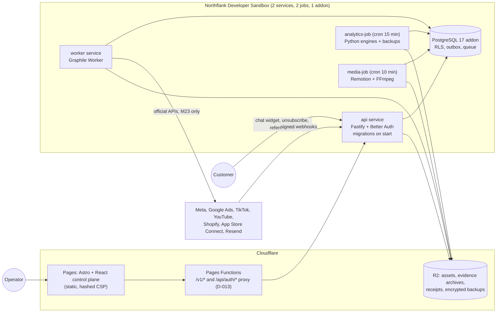
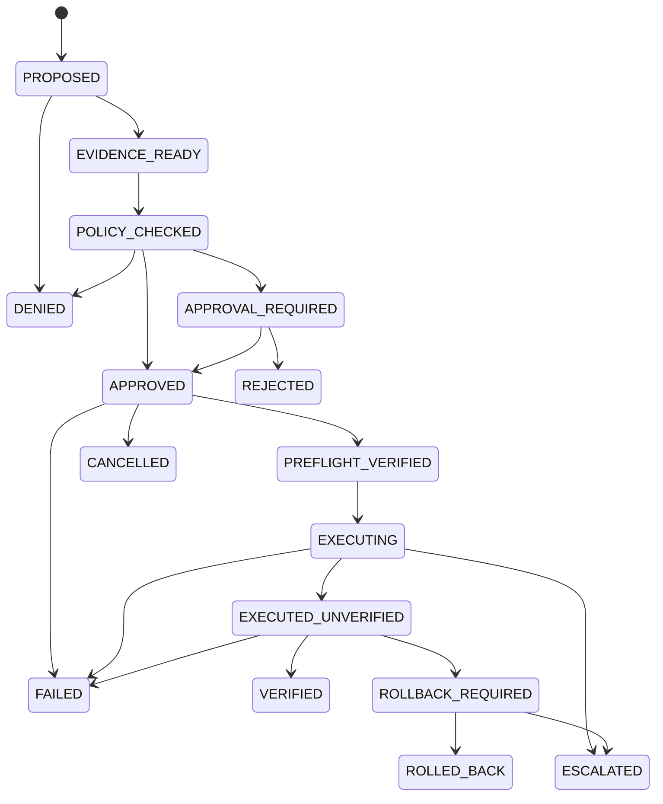

# FUTUREGROW AI — Architecture

FUTUREGROW is an evidence-governed growth platform with bounded autonomy. Models *propose*; deterministic code owns evidence checks, policy, budgets, approvals, idempotency, execution, independent verification and audit. This document describes what is built in this repository. Decisions are numbered in [`DECISIONS.md`](../DECISIONS.md) (D-xxx); external blockers in [`BLOCKERS.md`](../BLOCKERS.md) (B-xxx). Generated references: [modules](MODULES.md), [events](EVENT_TAXONOMY.md), [connector capabilities](CONNECTOR_CAPABILITIES.md), [policy matrix](POLICY_MATRIX.md).

## 1. Topology (controlled beta)

The Sandbox is for development and a controlled beta only; a public production launch upgrades compute rather than weakening verification or media fidelity (tech stack §"Final verdict").

## 2. Repository layout

| Path | Contents |
|---|---|
| `packages/contracts` | Zod schemas and enums shared everywhere: action allowlist, state machine, evidence, events, 24-module registry, canonical JSON. |
| `packages/db` | Drizzle schema, SQL migrations (`drizzle/`), RLS/role application, hash-chained audit, tenancy helpers (`withTenant`, `withSystem`, `sequential`). |
| `packages/policies` | Deterministic policy engine `fg-policy-1.0.0` and approval-group matching. |
| `packages/connectors` | Official-API executors (execute / verify / rollback), read connectors, SSRF-guarded public fetch, robots.txt, webhook signature verifiers, capability seeds. |
| `packages/agent-kernel` | Model gateway (registry-gated, circuit breaker, schema re-validation, secret scan, served-by check), Anthropic and OpenAI-compatible adapters, versioned prompts, safety utilities. |
| `packages/core` | All 24 modules: `m01-evidence` … `m24-governance`, connections, webhooks, agents. |
| `packages/runtime` | Environment schema, runtime construction (DB, storage, queue, model gateway), Northflank job triggers. |
| `packages/storage`, `events`, `experiments`, `observability` | R2/filesystem object store; outbox events and bus; deterministic bucketing and SRM; hashing, logging with redaction, typed errors. |
| `apps/api` | Fastify app: auth, `/v1` routes, public channel endpoints, webhooks, OpenAPI 3.1. |
| `apps/worker` | Graphile Worker task list and cron schedules. |
| `apps/web` | Astro + React control plane, Pages Functions proxy, header generation. |
| `jobs/analytics` | Python engines (forecasting, MMM, experiments, trends, topics, propensity) and encrypted backups. |
| `jobs/media` | Remotion compositions and the render job. |
| `infra/` | Dockerfiles, Northflank template, Cloudflare configuration. |
| `test/` | Embedded PostgreSQL harness, fixture HTTP server, red-team suite. |

## 3. Requests, identity and tenancy

1. Better Auth issues sessions (email + password, TOTP second factor, organizations). Sign-up is invite-only by default.
2. `resolveActor` loads the session, the tenant (`x-fg-tenant` header or the active organization) and verifies membership; roles come from the membership, never from the client.
3. Every tenant query runs inside `withTenant`: a transaction that sets `app.tenant_id` and `SET LOCAL ROLE fg_tenant`. PostgreSQL row-level security (`fg_tenant_isolation`) is applied automatically to every table with a `tenant_id` column (`fg_apply_security()` after each migration). Platform tables without `tenant_id` (registries, backup runs) are not granted to the tenant role.
4. Every `/v1` mutation requires an `Idempotency-Key`; replays return the stored response, payload changes under the same key are rejected (D-010).
5. Approvals, kill switches, policy changes and connections require an MFA-enrolled account.

## 4. The action pipeline (M23 + M24)

* **Proposal** — any module (or an agent) creates an `ActionRequest` for an allowlisted type with typed params. Unknown types are rejected and audited. The canonical payload hash binds approvals.
* **Evidence and policy** — evidence is resolved (D-023) and the policy engine decides ALLOW / REQUIRE_APPROVAL / DENY with reasons and approval groups (distinct people, never the proposer).
* **Preflight** — at execution time policy is re-evaluated in the same transaction (consent, suppression, kill switches, approvals still valid), credentials are decrypted, local rate limits and budget reservations are taken, and module resolvers render the exact connector input (D-026). Kill switches are checked once more immediately before the provider call.
* **Execution** — the connector call carries an idempotency key; failures are classified *before_send* / *rejected* (nothing applied → FAILED) or *ambiguous* (may have applied → ESCALATED with an incident, never retried blindly). Receipts and raw responses are archived to object storage with SHA-256.
* **Verification** — a separate step re-reads provider state (read-after-write, status poll, readback) and writes an `ExecutionProof`. Database triggers forbid `VERIFIED` without a postcondition proof with verdict VERIFIED and `ROLLED_BACK` without a verified rollback proof. There is no SUCCESS state.
* **Hooks** — modules react inside the terminal transaction (e.g. a social post becomes `published_verified`, a budget change enters the authorized-spend history, an email becomes `delivered`).

## 5. Evidence (M01)

Every fact that can drive a decision is an evidence record with source, licence/usage rights, PII class, lawful basis, permitted/prohibited uses, confidence, observed time and freshness SLA. Records missing rights or lawful basis are quarantined until a reviewer resolves them. Automation needs current evidence permitted for `autonomous_execution`; system producers (journeys, syncs, audits, reports) declare SLAs explicitly.

## 6. Agent kernel

* Models only return structured output validated against the schema twice (provider constraint + full Zod contract, one repair attempt). They have no tools and cannot write.
* Untrusted text (comments, pages, documents, customer messages) is fenced with an unguessable id; retrieved excerpts with injection markers are withheld (red-team suite, FG-P1-005).
* Outputs are scanned for credential patterns and live process secrets; matches abstain.
* Model use is gated by the model registry (approved models, purposes, terms, prices); every response's served-by model is checked; costs go to the cost ledger. Kill switches at agent and model scope stop runs before any call.
* Abstention is a first-class outcome: no model, missing evidence, refusal or kill switch produce a recorded abstention, never fabricated output.

## 7. Customer data, consent and privacy

Identity resolution uses keyed hashes (pepper) and explainable merge rules. Consent is append-only with newest-capture-wins state; suppressions are checked by hash. DSAR deletion propagates to events, identifiers, consent state, segments, scores, journeys, installs, conversations and evidence content, with documented exemptions; opt-out withdraws sale/share/profiling consents. Connection credentials are AES-256-GCM encrypted with per-connection AAD; customer text sent to models is PII-redacted.

## 8. Events, jobs and webhooks

* Transactional outbox → `graphile_worker.add_job` via a SECURITY DEFINER trigger (exactly the committed events, at least once).
* Webhooks are verified at the edge, stored once in an inbox (unique provider event id) and processed asynchronously by module handlers.
* Worker schedules (UTC):

| Schedule | Task |
|---|---|
| `*/5 * * * *` | watchdog (stuck actions, lost webhook jobs) |
| `7 * * * *` | evidence freshness sweep |
| `17 * * * *` | connector health |
| `23 3 * * *` | webhook retention |
| `13 * * * *` | competitor crawl (approved sources) |
| `41 2 * * *` | claims expiry sweep |
| `27 6 * * *` | Growth Brain cycle (proposals only) |
| `* * * * *` | social scheduler; journey enrolment and steps |
| `37 */6 * * *` | ads campaign + spend sync |
| `15 7 * * *` | spend reconciliation (last 7 settled days) |
| `45 5 * * *` | Search Console sync |
| `5 9 * * *` | App Store Connect sales report |

* The **analytics job** claims queued analytics requests with `FOR UPDATE SKIP LOCKED`, runs each inside RLS, records results as evidence, and then takes/verifies the daily encrypted backup (D-030).
* The **media job** claims render jobs, re-checks the Remotion licence attestation and input hashes, renders with a prebuilt bundle, runs technical QA and writes the asset with an inherited rights manifest and provenance evidence.

## 9. Security controls (summary)

| Control | Where |
|---|---|
| Tenant isolation | PostgreSQL RLS + role switch per transaction; cross-tenant tests |
| Immutable audit | Hash chain per tenant with chain-head lock; append-only triggers on audit, approvals, proofs, consent, ledgers, budget history |
| Separation of duties | Approval groups, distinct approvers, author ≠ approver for templates, listings, journeys, personas |
| Spend safety | Reservations, per-action and 24 h ceilings, settled-day ledger, reconciliation with alerts |
| Network safety | SSRF guard on resolved addresses, robots.txt, size/time caps; per-widget CORS; hashed CSP on the web app |
| Supply chain | Lockfile installs without install scripts in images, pinned base-image digests, SHA-pinned CI actions, CycloneDX SBOM with licence policy; new dependencies chosen at least two weeks after release |
| Secrets | Encrypted credentials, redacted logs, model-output secret scanning, backup key separate from storage credentials |
| Kill switches | System, tenant, connector, object, model, agent; checked at preflight and immediately before send |
