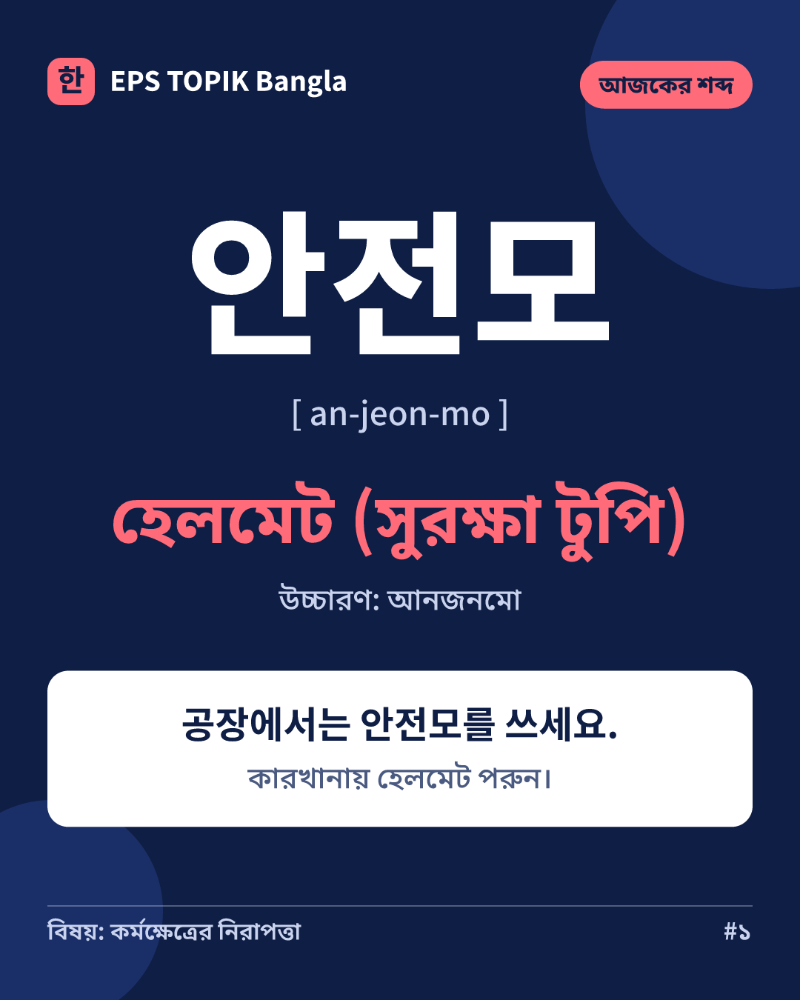
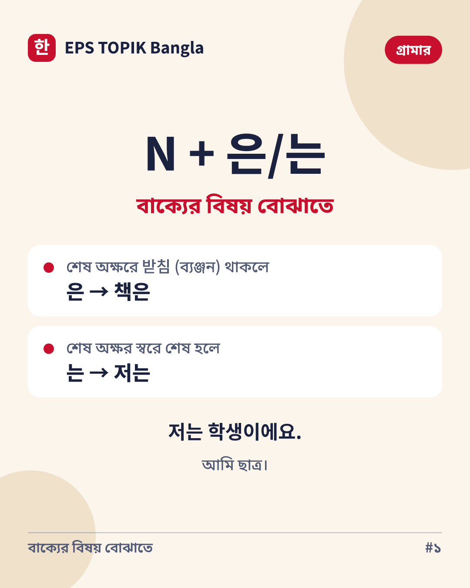
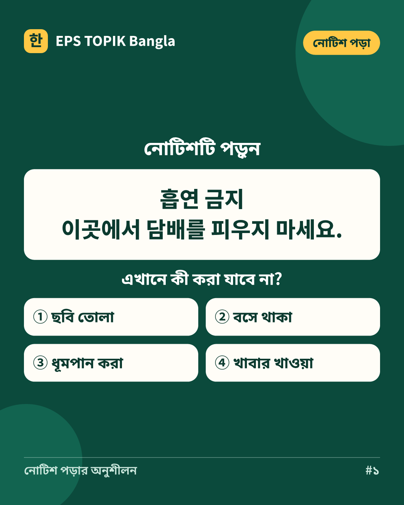

# D-040 Content Studio report

Production preview snapshot: 2026-11-02 09:16 UTC; API revision aefa8b5.

The three upcoming previews were rendered by the existing production API. Each passed card QA, caption lint, card-text lint and Korean curriculum verification. These are previews, not queued publications; numbering, captions and variants are checked again when the scheduled cycle drafts the post.

## Image source

Selected: the existing premium branded-template fallback. No approved image-generation or stock-image provider is configured. The cards use the verified curriculum, HarfBuzz shaping, resvg rasterization and licensed Noto Korean/Bengali fonts. M14 records the template, source-media and font rights, provenance, QA and exact-byte hash. No provider purchase or new model is needed.

## Previews

### 2026-11-03: vocab (EDUCATE)



1080 ? 1350 PNG; smallest type 32px; minimum contrast 5.9:1; QA, both copy-lint checks and curriculum verification passed.

```text
আজকের শব্দ: 안전모 — হেলমেট ✍️

🇰🇷 안전모 (an-jeon-mo)
🇧🇩 অর্থ: হেলমেট (সুরক্ষা টুপি)
🗣️ উচ্চারণ (কাছাকাছি): আনজনমো

✍️ উদাহরণ:
공장에서는 안전모를 쓰세요.
→ কারখানায় হেলমেট পরুন।

✍️ 안전모 দিয়ে নিজে একটা বাক্য বানিয়ে কমেন্টে লিখুন।

#কোরিয়ান_শিখি #কোরিয়ান_শব্দ
```

### 2026-11-04: grammar (DISCOVER)



1080 ? 1350 PNG; smallest type 32px; minimum contrast 5.43:1; QA, both copy-lint checks and curriculum verification passed.

```text
N + 은/는 কখন বসে? ছোট করে বুঝে নিই 👇

📌 N + 은/는 — বাক্যের বিষয় বোঝাতে
কার বা কীসের কথা বলছেন, তা বোঝাতে বিশেষ্যের পরে 은/는 বসে।

• শেষ অক্ষরে 받침 (ব্যঞ্জন) থাকলে: 은 → 책은
• শেষ অক্ষর স্বরে শেষ হলে: 는 → 저는

উদাহরণ:
저는 학생이에요.
→ আমি ছাত্র।
이 책은 한국어 책이에요.
→ এই বইটা কোরিয়ান ভাষার বই।

✍️ এই নিয়মে নিজে একটা বাক্য লিখে কমেন্টে দিন।

📱 EPS Topik Bangla অ্যাপে বাংলা ব্যাখ্যাসহ কোরিয়ান গ্রামার শেখা যায়।

#কোরিয়ান_শিখি #কোরিয়ান_গ্রামার
```

### 2026-11-05: reading (ENGAGE)



1080 ? 1350 PNG; smallest type 32px; minimum contrast 7.78:1; QA, both copy-lint checks and curriculum verification passed.

```text
নোটিশটা পড়তে পারছেন? 🪧

🪧 নোটিশ:
흡연 금지
이곳에서 담배를 피우지 마세요.

❓ এখানে কী করা যাবে না?
১) ছবি তোলা
২) বসে থাকা
৩) ধূমপান করা
৪) খাবার খাওয়া

💬 আপনার উত্তর (১/২/৩/৪) কমেন্টে লিখুন।

.
.
.
✅ উত্তর: ৩) ধূমপান করা
흡연 = ধূমপান, 금지 = নিষেধ।

#কোরিয়ান_শিখি #EPSTOPIK
```

## Campaign tracking and real analytics

Store URLs preserve the verified Play package ID and carry an encoded Play referrer: utm_source=facebook, utm_medium=organic_social, utm_campaign=eps_daily, and utm_content identifying the lesson/post. The first-week plan contains no store link. Campaign installs require Play Console acquisition data; it is not imported and no conversion counts are invented.

At this snapshot the studio has zero published or measured lessons. The goal has one earlier verified text post, but its last measurement is insufficient_data: reactions, comments and shares are null, with no observation timestamp or evidence ID. No engagement KPI series exists. Reach, impressions and link clicks require read_insights and sufficient data returned by Meta. The studio learns from evidence-backed Page counters after publication; the live photo-publication outcome remains dependent on the next scheduled cycle.

## Integration and focused fixes

The existing worker/connector integration tests exercise the full lesson ? asset ? M23 ? Facebook photo upload ? read-back path against a fixture Graph API. They verify uploaded bytes against the asset hash, caption and photo read-back, curriculum/policy checks, daily deduplication and observed post counters. No real Facebook post was manually published.

Saved-card previews now include the persisted post caption, and report totals include today's published lesson. Regression assertions cover both and decoding the campaign referrer. The Content Studio identifies the current template image source.

## Schedule

Goal fe9be4e0 remains active. Its next run is 2026-11-03T05:43:58.649Z, with cadenceHours=24, maxCyclesPerDay=1, maxOpenActions=1 and maxAiCallsPerDay=4. This work does not command, pause, resume or reschedule the goal.

## Validation

- Focused baseline: 79 tests passed across studio, visuals, connectors, policies and worker integration.
- After the fixes: typecheck passed; lint passed with 88 existing warnings and one configuration deprecation notice.
- Full TypeScript suite: 364 passed, 2 skipped across 43 files (FG_SKIP_RENDER=1, matching the main CI verify job). The separate CI render job exercises Remotion.
- Production web build passed. Graphify AST update completed.
- All three production previews passed QA, caption/card lint and curriculum verification; each image was visually inspected.
